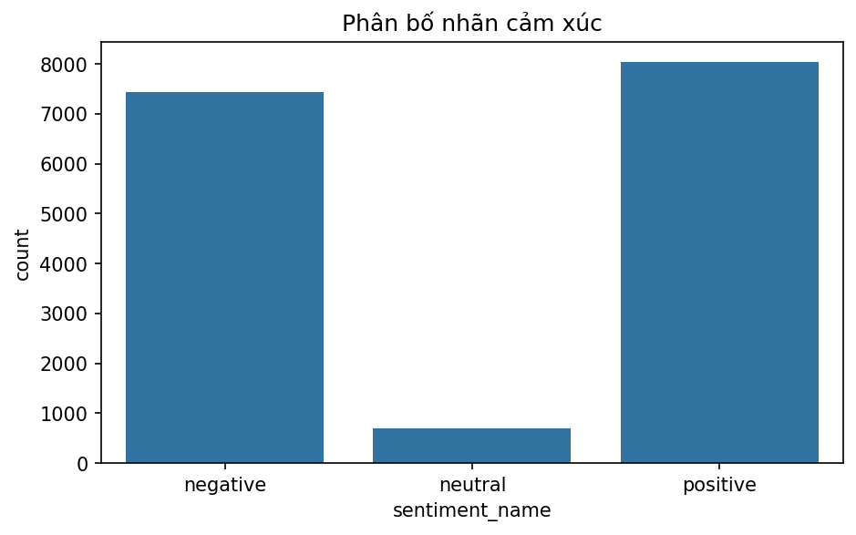
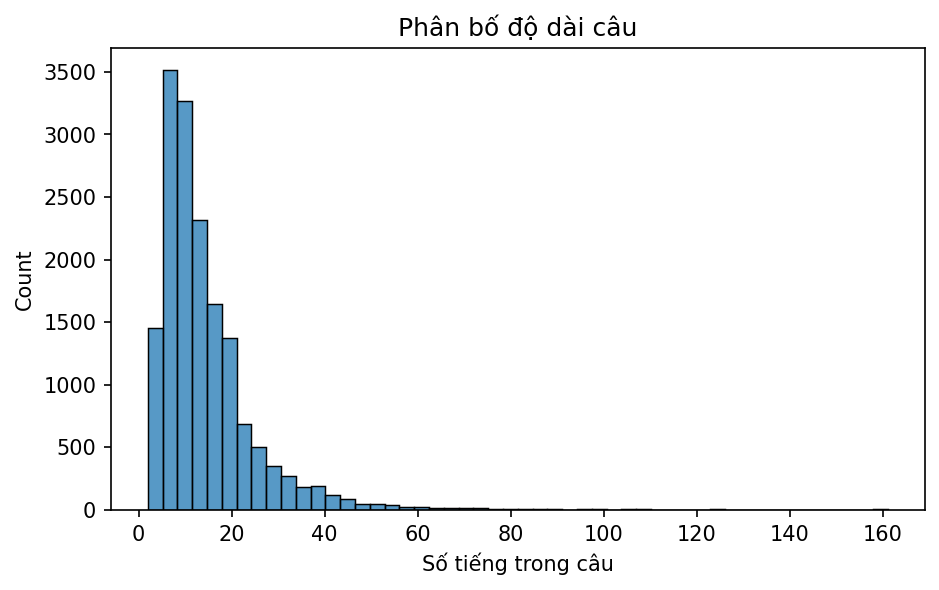

# vsfc-sentiment-analysis

## Phân tích cảm xúc phản hồi sinh viên tiếng Việt (UIT-VSFC)

Project 1 - Vũ Huy Tâm - 202416347
Giảng viên hướng dẫn: Đỗ Tuấn Anh

## Mục tiêu

Phân loại câu phản hồi của sinh viên thành 3 lớp: tích cực / trung tính / tiêu cực, và so sánh ba hướng tiếp cận:

- Mô hình ML truyền thống (TF-IDF + SVM / Logistic Regression / ...)
- BiLSTM
- PhoBERT (`vinai/phobert-base`)

Metric chính: **Macro-F1**, kèm Precision / Recall từng lớp và confusion matrix.

## Dữ liệu

UIT-VSFC (Vietnamese Students' Feedback Corpus): khoảng 16.000 câu phản hồi của sinh viên, đã chia sẵn train / dev / test. Project chỉ dùng **nhãn cảm xúc**, không dùng nhãn chủ đề.

Repo này không đăng lại dữ liệu, chỉ có notebook để tải về từ Google Drive. Dữ liệu thuộc về nhóm tác giả gốc.

## Cấu trúc repo

```
vsfc-sentiment-analysis/
├── README.md
├── notebooks/
│   ├── 01_check_env.ipynb
│   ├── 02_eda.ipynb
│   └── 03_preprocess.ipynb
├── src/
│   └── preprocess.py
└── results/
    ├── fig_sentiment_dist.png
    ├── fig_length_hist.png
    ├── fig_length_by_sentiment.png
    └── preprocess_log.md
```

## Danh sách notebook

| Notebook | Nội dung | Trạng thái |
|---|---|---|
| `01_check_env` | Cài môi trường, tải dữ liệu | Xong |
| `02_eda.ipynb` | Khảo sát dữ liệu: phân bố nhãn, độ dài câu, từ đặc trưng theo lớp, câu có từ nối đối lập | Xong (khảo sát sơ bộ) |
| `03_preprocess.ipynb` | Tiền xử lý, tách từ VnCoreNLP, tạo `data_clean.csv` | Xong |
| `04_ml_baseline.ipynb` | ML truyền thống | Chưa |
| `05_bilstm.ipynb` | BiLSTM | Chưa |
| `06_phobert.ipynb` | Fine-tune PhoBERT | Chưa |

## Hướng dẫn thiết lập (notebook 01)

Chạy trên Google Colab, lần lượt các bước:

1. **Mount Google Drive và tạo thư mục project** tại `MyDrive/project1_vsfc/` gồm `data`, `notebooks`, `checkpoints`, `results`.
2. **Cài thư viện:** `pip install -q transformers datasets underthesea` (`torch` và `scikit-learn` đã có sẵn trên Colab).
3. **Kiểm tra tokenizer PhoBERT:** `AutoTokenizer.from_pretrained("vinai/phobert-base")`. Cảnh báo về `HF_TOKEN` có thể bỏ qua.
4. **Tải dữ liệu** bằng `gdown --folder` vào thư mục `data/`.

Cấu trúc dữ liệu sau khi tải:

```
data/
├── README.txt
├── train/  (sents.txt, sentiments.txt, topics.txt)
├── dev/    (sents.txt, sentiments.txt, topics.txt)
└── test/   (sents.txt, sentiments.txt, topics.txt)
```

Dòng thứ *i* trong `sents.txt` ứng với dòng thứ *i* trong `sentiments.txt` của cùng split.

Lưu ý:
- Notebook 03 cần thêm `py_vncorenlp` và Java (Colab đã có sẵn Java), model VnCoreNLP được tải tự động ở lần chạy đầu.
- Nếu đổi tên thư mục trên Drive, sửa biến `PROJECT` trong notebook.
- Nếu `gdown` báo lỗi quota, đợi một lúc rồi chạy lại.

## Kết quả khảo sát dữ liệu (notebook 02)

Khảo sát sơ bộ để hiểu dữ liệu và chọn tham số cho các bước sau.

- **Quy mô và chất lượng:** 16.175 câu (train 11.426 / dev 1.583 / test 3.166). Không có câu rỗng, không có câu trùng giữa các split (không rò rỉ dữ liệu).
- **Lệch lớp:** positive 49,7% / negative 46,0% / neutral 4,3% (698 câu). Vì vậy dùng Macro-F1 và sẽ thử class weight.
- **Độ dài:** trung vị 11 token, p99 là 52. Sau tokenizer PhoBERT, p99 là 39 subword nên chọn `max_length = 128` (PhoBERT) và 64 (BiLSTM).
- **Theo lớp:** negative dài nhất (trung bình 16,9 token), neutral ngắn nhất (9,8), positive 12,1.
- **Câu có từ nối đối lập** (nhưng, tuy nhiên, ...): 4,3% tổng số câu, trong đó 76% có nhãn negative.




## Tiền xử lý (notebook 03)

Toàn bộ luật nằm trong `src/preprocess.py` (`clean_text`, `segment`). Chi tiết từng quyết định và số liệu căn cứ xem `results/preprocess_log.md`.

- `clean_text`: chuẩn hóa NFC, chữ thường, thống nhất dấu thanh về kiểu mới (hoà, thuỷ), chuẩn hóa viết tắt không mơ hồ (ko, đc, trc, ...), đổi emoticon và ký hiệu mà README gốc thay bằng chữ (`colonsad`, `doubledot`, ...) về token chữ cái liền hoặc ký hiệu gốc.
- `segment`: tách từ bằng VnCoreNLP (từ ghép nối bằng `_`, ví dụ `giảng_viên`), đúng định dạng đầu vào của PhoBERT.
- Đầu ra `data/data_clean.csv` có 3 cột văn bản: `text_raw` (gốc), `text_clean`, `text_seg`, cùng các cột nhãn. Nhãn và cách chia tập không đổi so với `data_all.csv` (có assert kiểm tra).
- Giữ cả ba phiên bản văn bản để làm ablation ở các bước huấn luyện.
- Lưu ý đã biết: dấu thanh kiểu mới có thể làm một số từ bị PhoBERT cắt thành nhiều subword hơn; chưa đo ảnh hưởng.

## Kết quả mô hình

*(Sẽ cập nhật sau khi hoàn thành các thí nghiệm.)*
