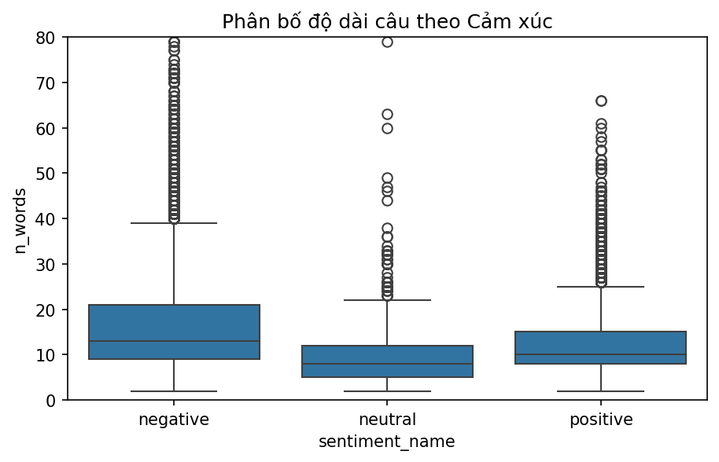
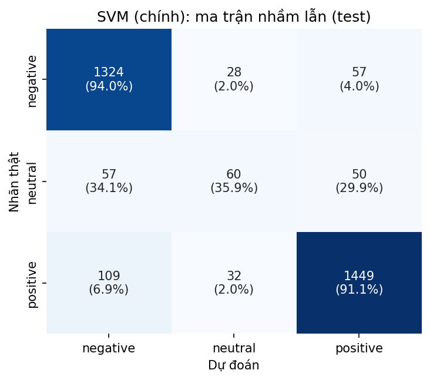

# vsfc-sentiment-analysis

## Phân tích cảm xúc phản hồi sinh viên tiếng Việt (UIT-VSFC)

Project 1 - Vũ Huy Tâm - 202416347
Giảng viên hướng dẫn: Đỗ Tuấn Anh

## Mục tiêu

Phân loại câu phản hồi của sinh viên thành 3 lớp: tích cực / trung tính / tiêu cực, và so sánh ba hướng tiếp cận:

- Mô hình ML truyền thống (TF-IDF + SVM / Logistic Regression / ...)
- BiLSTM
- PhoBERT (`vinai/phobert-base`)

Metric chính: **Macro-F1**, kèm Precision / Recall từng lớp và confusion matrix.

## Dữ liệu

UIT-VSFC (Vietnamese Students' Feedback Corpus): khoảng 16.000 câu phản hồi của sinh viên, đã chia sẵn train / dev / test. Project chỉ dùng **nhãn cảm xúc**, không dùng nhãn chủ đề.

Repo này không đăng lại dữ liệu, chỉ có notebook để tải về từ Google Drive. Dữ liệu thuộc về nhóm tác giả gốc.

## Cấu trúc repo

```
vsfc-sentiment-analysis/
├── README.md
├── notebooks/
│   ├── 01_check_env.ipynb
│   ├── 02_eda.ipynb
│   ├── 03_preprocess.ipynb
│   └── 04_ml_baseline.ipynb
├── src/
│   └── preprocess.py
└── results/
    ├── fig_sentiment_dist.png
    ├── fig_length_hist.png
    ├── fig_length_by_sentiment.png
    ├── preprocess_log.md
    ├── ml_baseline_log.md
    ├── ml_test_metrics.csv
    └── fig_cm_ml_best_test.png
```

## Danh sách notebook

| Notebook | Nội dung | Trạng thái |
|---|---|---|
| `01_check_env.ipynb` | Cài môi trường, tải dữ liệu | Xong |
| `02_eda.ipynb` | Khảo sát dữ liệu: phân bố nhãn, độ dài câu, từ đặc trưng theo lớp, câu có từ nối đối lập | Xong (khảo sát sơ bộ) |
| `03_preprocess.ipynb` | Tiền xử lý, tách từ VnCoreNLP, tạo `data_clean.csv` | Xong |
| `04_ml_baseline.ipynb` | Baseline ML: TF-IDF + LR / SVM / NB, chọn mô hình bằng dev và CV, chấm test | Xong |
| `05_bilstm.ipynb` | BiLSTM | Chưa |
| `06_phobert.ipynb` | Fine-tune PhoBERT | Chưa |

## Hướng dẫn thiết lập (notebook 01)

Toàn bộ project chạy trên Google Colab, lưu dữ liệu và kết quả trên Google Drive. Chạy các notebook theo thứ tự 01 → 02 → 03 → ...

1. **Mount Google Drive và tạo thư mục project** tại `MyDrive/project1_vsfc/` gồm `data`, `notebooks`, `src`, `checkpoints`, `results`.
2. **Cài thư viện:** `pip install -q transformers datasets underthesea` (`torch` và `scikit-learn` đã có sẵn trên Colab). `underthesea` chỉ dùng ở notebook 02 để ước lượng sơ bộ độ dài câu.
3. **Kiểm tra tokenizer PhoBERT:** `AutoTokenizer.from_pretrained("vinai/phobert-base")`. Cảnh báo về `HF_TOKEN` có thể bỏ qua.
4. **Tải dữ liệu** bằng `gdown --folder` vào thư mục `data/`.

Cấu trúc dữ liệu sau khi tải:

```
data/
├── README.txt
├── train/  (sents.txt, sentiments.txt, topics.txt)
├── dev/    (sents.txt, sentiments.txt, topics.txt)
└── test/   (sents.txt, sentiments.txt, topics.txt)
```

Dòng thứ *i* trong `sents.txt` ứng với dòng thứ *i* trong `sentiments.txt` của cùng split.

Lưu ý:
- Notebook 03 cần thêm `py_vncorenlp` và Java (Colab đã có sẵn Java), model VnCoreNLP được tải tự động ở lần chạy đầu.
- Nếu đổi tên thư mục trên Drive, sửa biến `PROJECT` trong notebook.
- Nếu `gdown` báo lỗi quota, đợi một lúc rồi chạy lại.

## Kết quả khảo sát dữ liệu (notebook 02)

Khảo sát sơ bộ để hiểu dữ liệu và chọn tham số cho các bước sau.

- **Quy mô và chất lượng:** 16.175 câu (train 11.426 / dev 1.583 / test 3.166). Không có câu rỗng, không có câu trùng giữa các split (không rò rỉ dữ liệu). Chỉ có 1 câu trùng nội dung nhưng khác nhãn, giữ nguyên.
- **Lệch lớp:** positive 49,7% / negative 46,0% / neutral 4,3% (698 câu). Vì vậy dùng Macro-F1 và class weight (xem notebook 04).
- **Độ dài:** trung vị 11 token, p99 là 52 (đếm theo khoảng trắng, gồm cả dấu câu). Độ dài đầu vào chốt cho mô hình được đo lại ở notebook 03.
- **Theo lớp:** negative dài nhất (trung bình 16,9 token), neutral ngắn nhất (9,8), positive 12,1.
- **Câu có từ nối đối lập** (nhưng, tuy nhiên, ...): 4,3% tổng số câu, trong đó 76% có nhãn negative.




## Tiền xử lý (notebook 03)

Toàn bộ luật nằm trong `src/preprocess.py` (`clean_text`, `segment`), notebook `03_preprocess.ipynb` tự ghi file này vào Drive khi chạy. Chi tiết từng quyết định và số liệu căn cứ xem `results/preprocess_log.md`.

- `clean_text`: chuẩn hóa NFC, chữ thường, thống nhất dấu thanh về kiểu mới (hoà, thuỷ), chuẩn hóa viết tắt không mơ hồ (ko, đc, trc, ...), đổi các emoticon và ký hiệu mà bộ dữ liệu đã thay bằng chữ (`colonsad`, `doubledot`, ...) về token chữ cái liền (`emosmile`, ...) hoặc ký hiệu gốc (`:`, `...`).
- `segment`: tách từ bằng VnCoreNLP (từ ghép nối bằng `_`, ví dụ `giảng_viên`), đúng định dạng đầu vào của PhoBERT.
- Đầu ra `data/data_clean.csv` có 3 cột văn bản: `text_raw` (gốc), `text_clean`, `text_seg`, cùng các cột nhãn. Nhãn và cách chia tập không đổi so với `data_all.csv` (có assert kiểm tra).
- Giữ cả ba phiên bản văn bản để làm ablation ở các bước huấn luyện.
- Độ dài đầu vào (đo trên `text_seg`, toàn bộ 16.175 câu, bằng tokenizer PhoBERT): trung vị 11, p99 = 45 subword, tối đa 136. Chọn `max_length = 128` cho PhoBERT (cắt 0,01% câu, tức 1 đến 2 câu) và 64 cho BiLSTM (đếm theo từ nên không vượt quá số subword, cắt dưới 0,21%).
- Lưu ý đã biết: dấu thanh được thống nhất về kiểu mới (theo kiểu chiếm đa số trong dữ liệu), nhưng PhoBERT được huấn luyện chủ yếu trên văn bản kiểu cũ nên một số từ có thể bị cắt thành nhiều subword hơn. Chưa đo ảnh hưởng, sẽ kiểm tra bằng ablation `text_raw` và `text_clean`.

## Kết quả mô hình

### Baseline ML truyền thống (notebook 04)

Đặc trưng TF-IDF trên `text_clean`; mô hình chọn bằng dev và cross-validation 5 fold trên train, tập test chấm đúng một lần. Chi tiết quyết định xem `results/ml_baseline_log.md`.

| Mô hình (test) | Macro-F1 | Accuracy | F1 negative | F1 neutral | F1 positive |
|---|---|---|---|---|---|
| **SVM** (`word(1,2)+char_wb(2,5)`, `C`=1, `balanced`) | **0,751** | 0,895 | 0,913 | 0,418 | 0,921 |
| Logistic Regression (cùng đặc trưng, `C`=10, neutral nặng gấp 6) | 0,733 | 0,887 | 0,906 | 0,373 | 0,918 |
| Naive Bayes (`word(1,1)`, `fit_prior=False`) | 0,652 | 0,815 | 0,834 | 0,258 | 0,865 |

Mô hình chính (SVM): Macro-F1 test = 0,751, khoảng tin cậy 95% theo bootstrap là [0,725; 0,775]. SVM hơn LR 0,018 (khoảng ghép cặp [0,010; 0,029]).



Nhận xét chính:
- Có class weight là bắt buộc: không dùng thì Recall của lớp neutral chỉ khoảng 0,15 đến 0,18, dù Accuracy cao nhất.
- Thêm bigram và n-gram ký tự cải thiện rõ; trigram không giúp. Tách từ (`text_seg`) không cho cải thiện ổn định ở mô hình ML, nên giữ `text_clean`.
- Tinh chỉnh `C` và trọng số lớp không vượt được cấu hình mặc định khi xét bằng cross-validation.
- Lớp neutral là điểm yếu: 107 trên 167 câu neutral trong test bị đoán sai (Recall 0,359). Điểm dev (0,783) lạc quan hơn test vì chỉ có 73 câu neutral.

### BiLSTM và PhoBERT

*(Sẽ cập nhật sau khi hoàn thành các thí nghiệm, dùng cùng split và cùng metric.)*
